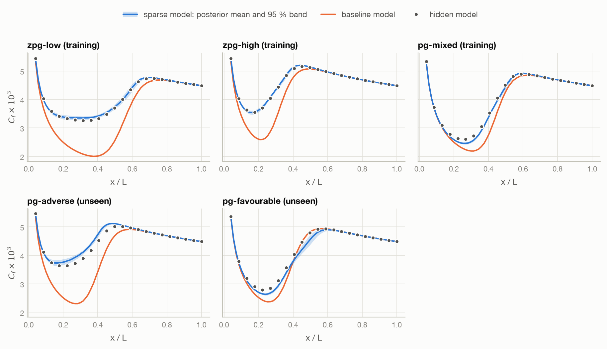
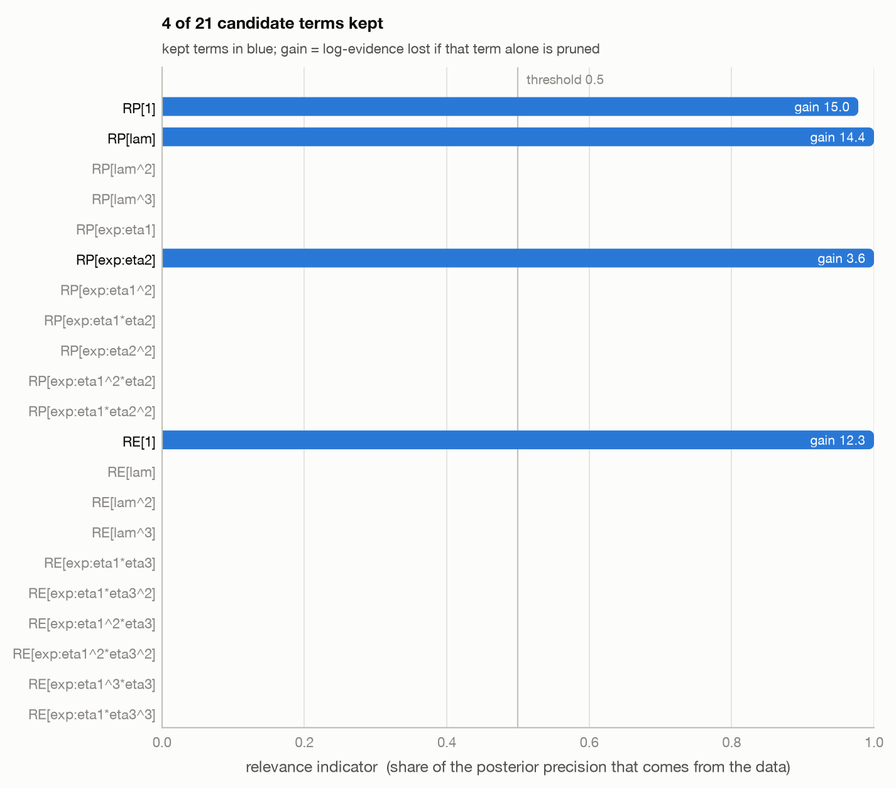
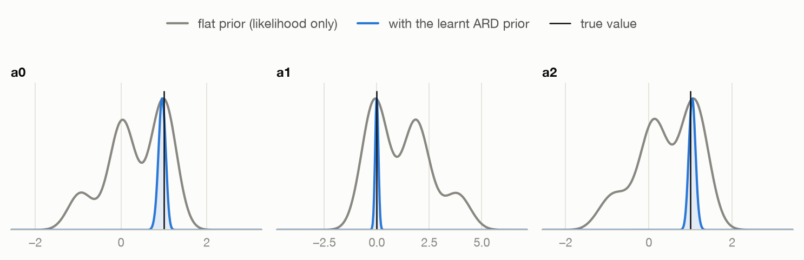

# sbl-cfd-driven

Nonlinear sparse Bayesian learning (NSBL) for CFD-driven discovery of sparse model
corrections.

The deterministic route to a sparse, interpretable correction of a RANS model fits
the coefficients of a dictionary of candidate terms through the solver (or its
surrogate) with an elastic-net penalty, and tunes the penalty by grid search or
bi-level optimisation against validation cases. This package is its probabilistic
counterpart: every candidate coefficient receives an automatic-relevance-determination
(ARD) prior whose precision is learnt from the data by maximising the model evidence.
Terms the data do not need are pruned, the others come with a posterior distribution,
and competing sparse structures are ranked by their evidence. No validation set and
no penalty hyperparameter are involved.

The core is an implementation of

> R. Sandhu, M. Khalil, C. Pettit, D. Poirel, A. Sarkar, *Nonlinear sparse Bayesian
> learning for physics-based models*, J. Comput. Phys. 426 (2021) 109728.

with the additions a surrogate-driven RANS application needs: sign-constrained
coefficients, bounded parameter boxes, batched POD-Kriging emulators and field
likelihoods.

<picture>
  <source media="(prefers-color-scheme: dark)" srcset="docs/img/transition_predictions_dark.png">
  
</picture>

*Output of `examples/04_transition_model_discovery.py`: a 4-term correction selected
among 21 candidates on a toy transition problem, pushed through the solver on three
training cases and two unseen ones.*

## Why NSBL and not an ℓ<sub>1/2</sub>-norm SBL

Two approaches were considered for the probabilistic counterpart.

| | ℓ<sub>1/2</sub>-SBL (Bai, 2023) | NSBL (Sandhu et al., 2021) |
|---|---|---|
| Model | linear, `x = A g + w`, with an explicit dictionary matrix `A` | any model; only `log p(D \| φ)` is needed, as a black box |
| Inference | EM whose E-step is a Gaussian posterior, exact only for a linear-Gaussian model | Gaussian-mixture approximation of the likelihood, built once from samples |
| Posterior shape | Gaussian | non-Gaussian, multimodal |
| Prior knowledge | every coefficient treated alike | questionable parameters (ARD prior) next to a priori relevant ones (any known prior) |
| Output | point estimate and covariance | evidence, relevance indicators, posterior, list of competing sparse models |

In CFD-driven training the map from the coefficients to the flow fields goes through
`exp(-Σ Γᵢ φᵢ)` and then through the RANS solver: it is not linear, there is no
dictionary matrix, and the loss is multimodal. The EM updates of the ℓ<sub>1/2</sub>
approach do not apply without linearising the solver. NSBL was designed for this
situation, which is why it is the approach implemented here. (For a model that *is*
linear, `sblcfd.linear` provides classical SBL; NSBL reduces to it exactly.)

## What is in the package

**Core (`sblcfd`)**

- `GaussianMixture`: mixtures with shared covariances (kernel density estimate,
  EM fit, single Gaussian) and their closed-form operations.
- `ARDEvidence`: evidence, gradient and Hessian in `log α`, written so that nothing
  cancels when a parameter is pruned; one Cholesky factorisation per distinct
  covariance. About 1 ms per evaluation for 5000 kernels and 21 parameters.
- `maximize_evidence`: multistart trust-region Newton; returns *all* distinct optima,
  i.e. the candidate sparse models.
- `SMCSampler`: vectorised tempered sequential Monte Carlo (TMCMC) for the one-off
  sampling stage, with the model evidence as a by-product.
- `NSBL`: the workflow, `sample → fit_mixture → optimize`, then
  `compare_structures` / `calibrate` / `model_average`.

**CFD layer (`sblcfd.cfd`)**

- `PODEmulator`, `KrigingPredictor`: POD-Kriging emulators evaluated for a whole
  population of coefficient vectors at once; can be trained here or rebuilt from a
  trained `smt.applications.PODI`.
- `FieldMisfit`, `FieldLikelihood`: masked field likelihoods evaluated in the POD
  coordinates (the field is never reconstructed), with the error variances
  integrated out and a tempering for spatial correlation.
- `likelihood_from_bilevel_data`: builds the likelihood from the dictionaries of the
  elastic-net / bi-level framework ([AugTransitionRANS](https://github.com/LouenasZm/AugTransitionRANS)).
- `CorrectionLibrary`, `transition_library`: the 21-term dictionary
  `(polynomial in λ) × exp(-Σ Γ φ)` with its bounds, and the printing of an identified
  model.

## Installation

```bash
git clone https://github.com/LouenasZm/CfdDrivenSBL.git
cd sbl_cfd_driven
python -m venv .venv && source .venv/bin/activate
pip install -e ".[dev]"        # numpy, scipy, scikit-learn + pytest, matplotlib, ruff
pytest
```

Python ≥ 3.10. Runtime dependencies: `numpy`, `scipy`, `scikit-learn`. `matplotlib`
is only needed for `sblcfd.plotting`; SMT is not required.

## Quick start

A model `y = a·x₁ + b·x₂ + noise` with non-negative coefficients, of which only `a`
is needed:

```python
import numpy as np
from sblcfd import NSBL, Parameter

rng = np.random.default_rng(0)
x1, x2 = rng.standard_normal(30), rng.standard_normal(30)
y = 0.8 * x1 + rng.normal(0.0, 0.3, 30)

def log_likelihood(phi):                       # phi: (n, 2) -> (n,)   vectorised
    residual = y - phi[:, :1] * x1 - phi[:, 1:] * x2
    return -0.5 * (residual**2).sum(axis=1) / 0.3**2

model = NSBL(log_likelihood, [Parameter("a", 0.0, 2.0), Parameter("b", 0.0, 2.0)])
model.sample(2000, seed=0)       # 1. draw from the likelihood, once
model.fit_mixture()              # 2. Gaussian-mixture approximation
result = model.optimize()        # 3. Newton iterations on the evidence
print(result.summary())
```

```text
NSBL: log-evidence = -19.9054; 1 of 2 questionable parameters kept (relevance > 0.5); 1 distinct optima
  parameter  log(alpha)  relevance      gain  status         mean         std
  a               0.399      0.999    546.52  kept         0.8153       0.068
  b              35.897      0.000      0.00  pruned    1.274e-08    9.63e-09
  (gain: log-evidence lost if that term alone is pruned)
```

A `Parameter` without a prior is *questionable* and gets an ARD prior; give it
`prior=Uniform(...)`, `Normal(...)`, ... to declare it a priori relevant instead.
Samples obtained elsewhere (emcee, PyMC, ...) can be supplied with
`model.set_samples(samples)`.

## CFD-driven workflow

`examples/04_transition_model_discovery.py` runs the complete workflow on a toy
transition model that stands in for the RANS solver (it runs in milliseconds; the
structure of the problem is the real one: 21 coefficients, sign constraints, several
flow cases, a collinear dictionary). Abridged:

```python
from sblcfd import NSBL, model_average
from sblcfd.cfd import (FieldLikelihood, FieldMisfit, PODEmulator,
                        effective_sample_size, transition_library)

library = transition_library()                       # 21 candidate terms and their bounds
emulator = PODEmulator.fit(design, snapshots)        # one per (flow case, quantity)
term = FieldMisfit(emulator, reference, rows=mask_rows, name="T3A/u")
term.n_eff = effective_sample_size(term.residual_field(baseline, grid_shape))
likelihood = FieldLikelihood(terms)                  # error variances integrated out

model = NSBL(likelihood, library.parameters(), truncate_prior=True)
model.sample(4000)                                   # the only stage that calls the emulators
model.fit_mixture()
result = model.optimize(n_starts=32)                 # candidate sparse structures
ranked = model.compare_structures(n_candidates=5)    # ranked by sampled evidence
draws = model_average(ranked, 300)                   # coefficient vectors for the solver
print(library.format(ranked[0].mean(), active=ranked[0].active))
```

Result on the toy problem (hidden model: 6 terms; data: 3 training cases, signal to
noise ratio 3):

```text
Identified model (posterior mean ± standard deviation):
  RP = (0.459(±0.047) - 0.734(±0.08) lam) * exp(-[0.815(±0.12) eta2])
  RE = 0.79(±0.089)

Skin friction through the solver (relative rms error against the hidden model):
  zpg-low        (training)  baseline  18.4 %  ->  sparse model  1.1 %
  zpg-high       (training)  baseline  10.5 %  ->  sparse model  0.5 %
  pg-mixed       (training)  baseline   7.1 %  ->  sparse model  1.8 %
  pg-adverse     (unseen  )  baseline  15.9 %  ->  sparse model  2.6 %
  pg-favourable  (unseen  )  baseline   5.0 %  ->  sparse model  2.8 %

Wall time: emulators 7.7 s, sampling 17.7 s, sparse learning 2.1 s, ranking 2.1 s
```

<picture>
  <source media="(prefers-color-scheme: dark)" srcset="docs/img/transition_relevance_dark.png">
  
</picture>

Read the result for what it is. The selected model has 4 terms instead of 21, the
right polynomial structure in the pressure-gradient parameter and the two constants
of the hidden model, and all 32 Newton runs agree on it. It is *not* the model that
generated the data, which has 6 terms: one exponent term is replaced by a collinear
one and the two weakest terms are missed, because three training cases do not
identify them. The evidence is candid about it: the log Bayes factor against the full
21-term model is only +0.7, so the sparse model is preferred for its simplicity, not
because it fits better. The 95 % bands are conditional on the selected structure and
are too narrow on the unseen cases. Timings are for an Apple M5 laptop, single
process; sampling made 825,700 likelihood evaluations at 21 µs each.

### With your own SMT surrogates

If the surrogates and LES fields are organised as in the bi-level framework
(`{"surrogates": {case: {var: model}}, "les": {...}, "baseline": {...}}`):

```python
from sblcfd.cfd import likelihood_from_bilevel_data

likelihood = likelihood_from_bilevel_data(follower_data, cases, variables, s_star_threshold=0.6)
likelihood.normalised_loss(x)     # equals compute_normalised_loss(x, cases, variables, data)
```

Each SMT `PODI` model is rebuilt as a batched emulator, checked against
`surrogate.predict` on random points of the design box, and replaced by the original
`predict` if the two disagree. `examples/05_from_bilevel_framework.py` is a template
for the complete study. It has not been run here: neither SMT nor the surrogates are
available on the machine this was developed on, so the SMT path is covered only by
tests that mimic SMT's attributes.

## Relation to the deterministic approach

| Elastic net + bi-level optimisation | NSBL |
|---|---|
| loss: masked, baseline-normalised MSE | likelihood built on the same masked misfit |
| penalty `α‖Γ‖₁ + β‖Γ‖₂²`, two global hyperparameters | one prior precision per coefficient: an adaptive ridge |
| hyperparameters tuned on validation cases | precisions set by maximising the evidence of the training data |
| one coefficient vector per hyperparameter pair, clustered | distinct optima of the evidence = candidate structures, ranked by evidence |
| point estimate | posterior of the coefficients, predictive bands, Bayes factors |

With `noise="fixed"`, `sigma² = κ · MSE_baseline` and the same `n_eff` for every field,
the posterior is exactly a Gibbs posterior of the deterministic loss,
`∝ exp(-T · L_MSE)`.

## Beyond the paper

These points are not in the paper and are documented, with derivations, in
[`docs/theory.md`](docs/theory.md).

- **Sign-constrained coefficients.** A coefficient restricted to `[0, u]` carries a
  half-normal ARD prior. For a kernel mixture the NSBL formulas are unchanged; only
  the posterior is folded back.
- **Bounded boxes.** `truncate_prior=True` normalises the ARD priors on the admissible
  box, so the model tends to the uniform-prior model when a precision vanishes.
- **Numerically stable evidence derivatives**, expressed through `(Σ + A⁻¹)⁻¹` only.
- **Scale invariance.** Hyperprior, bounds and starting points act on the
  dimensionless precision `α·Var(φ)`.
- **Minimum evidence gain.** A fitted precision always does at least as well as
  pruning, and once a prior is narrower than the kernels the evidence is flat. Terms
  are kept only if they raise the log-evidence by more than `evidence_tol` (one nat by
  default; zero gives the rule of the paper), and the `evidence_gain` of every term is
  reported next to its relevance indicator.
- **Sampler.** Cross-fitted proposals (tuning a proposal on the particles it moves
  biases the evidence by `O(d²/N)`), an exact Hastings correction for reflected
  correlated random walks, and independence moves when the target is near Gaussian.
- **Exact re-ranking.** `compare_structures` calibrates the candidate structures
  directly; `model_average` averages over them.
- Eq. (B.14) of the paper (posterior cross-covariance) is replaced by
  `C − Σ_α B⁻¹ C`.

## What to decide, and what to distrust

- **The Gaussian-mixture evidence is approximate, increasingly so with dimension.**
  On the 21-parameter example it overestimates the evidence of the selected structure
  by about 4 nats compared with direct sampling, and in a variant with four training
  cases it overestimated a candidate that sampling then rejected by 20 nats. Use it to
  *search* for structures and `compare_structures` to *rank* them. `fit_mixture`
  picks a kernel density estimate up to 8 parameters and an EM mixture beyond.
- **`n_eff`.** Mesh points are not independent observations. Treating them as such
  gives a posterior that is far too narrow and keeps every term.
  `effective_sample_size` estimates the number of independent values from a residual
  field; it is a modelling choice and the result depends on it.
- **Emulator error is not in the likelihood.** Where it is comparable to what the
  correction has to explain, it steers the selection. Check the emulators first.
- **Posteriors are conditional on the structure.** Bands from a single structure are
  too narrow; `model_average` widens them but only over the candidates it is given.
- **Collinear dictionaries have no unique sparse model.** `result.optima`,
  `result.inclusion_probability()` and the evidences of `compare_structures` show how
  many structures are competitive.

## Checked against the paper

| Paper | This package |
|---|---|
| §2.7: NSBL reduces to SBL for a linear model | evidence equal to the closed form to 10⁻⁹; same 47 of 84 chaos terms as SBL on the Ishigami function, coefficients equal to 2·10⁻⁸ |
| §3.1: fewer evidence evaluations than SBL | 35 against 93 |
| §3.2: `log α = [5.24, 0.00]` (global), `[-1.42, 6.76]` (local) | `[5.07, -0.09]` and `[-1.46, 5.35]`, from the same two starting points |
| §3.3: `log α = [-5.02, 4.03, 4.42]`, only `c1` kept | `[-4.65, 5.36, 5.30]`, only `c1` kept; log Bayes factor of the sparse model +7.3 |

The data are regenerated with other random numbers, so the values cannot coincide. One
difference is deliberate: §3.3 is run with a noise standard deviation of 0.05. With
the "variance of 0.1" quoted in the paper the damping distribution is ambiguous on
this problem (several modes; the selection changed with the noise realisation in the
runs made here).

<picture>
  <source media="(prefers-color-scheme: dark)" srcset="docs/img/polynomial_marginals_dark.png">
  
</picture>

*§3.2, `examples/02_multimodal_polynomial.py`: the three-mode likelihood and the
posterior at the global optimum of the evidence.*

## Examples

| Script | Content | Time |
|---|---|---|
| `01_sparse_pce_ishigami.py` | linear case, NSBL ≡ SBL (paper §3.1): same 47 of 84 terms, 35 evidence evaluations against 93 | < 1 s |
| `02_multimodal_polynomial.py` | multimodal prior and evidence (paper §3.2): the two optima of the paper are recovered | < 1 s |
| `03_mass_spring_damper.py` | nonlinear dynamics, sparse damping (paper §3.3): `log α = [-4.65, 5.36, 5.30]` against `[-5.02, 4.03, 4.42]` in the paper | ~ 25 s |
| `04_transition_model_discovery.py` | the CFD-driven workflow on a toy transition model | ~ 30 s |
| `05_from_bilevel_framework.py` | template for the SMT surrogates and LES data (not runnable as shipped) | |

## Layout

```text
src/sblcfd/
  mixture.py     Gaussian mixtures and their constructors
  evidence.py    evidence, gradient, Hessian, relevance, posterior
  optimize.py    multistart Newton
  smc.py         vectorised TMCMC sampler
  priors.py      known priors
  nsbl.py        the workflow
  linear.py      classical SBL and the linear special case
  plotting.py    figures
  cfd/           kriging, emulator, likelihood, library, adapters, toy model
tests/           pytest suite (derivatives, exactness, sampler, paper examples, CFD layer)
examples/        the five scripts above
docs/theory.md   the equations as implemented
```

## References

- R. Sandhu, M. Khalil, C. Pettit, D. Poirel, A. Sarkar, Nonlinear sparse Bayesian
  learning for physics-based models, *J. Comput. Phys.* 426 (2021) 109728.
- Z. Bai, Sparse Bayesian learning for sparse signal recovery using ℓ<sub>1/2</sub>-norm,
  *Appl. Acoust.* 207 (2023) 109340.
- M. E. Tipping, Sparse Bayesian learning and the relevance vector machine,
  *J. Mach. Learn. Res.* 1 (2001) 211–244.
- J. Ching, Y. Chen, Transitional Markov chain Monte Carlo method for Bayesian model
  updating, model class selection, and model averaging, *J. Eng. Mech.* 133 (2007)
  816–832.

## Licence

MIT, see [`LICENSE`](LICENSE).
